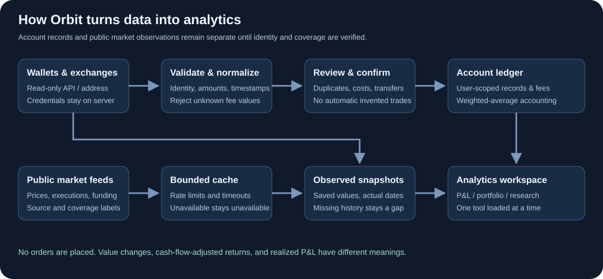
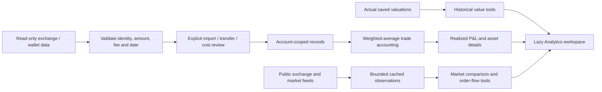
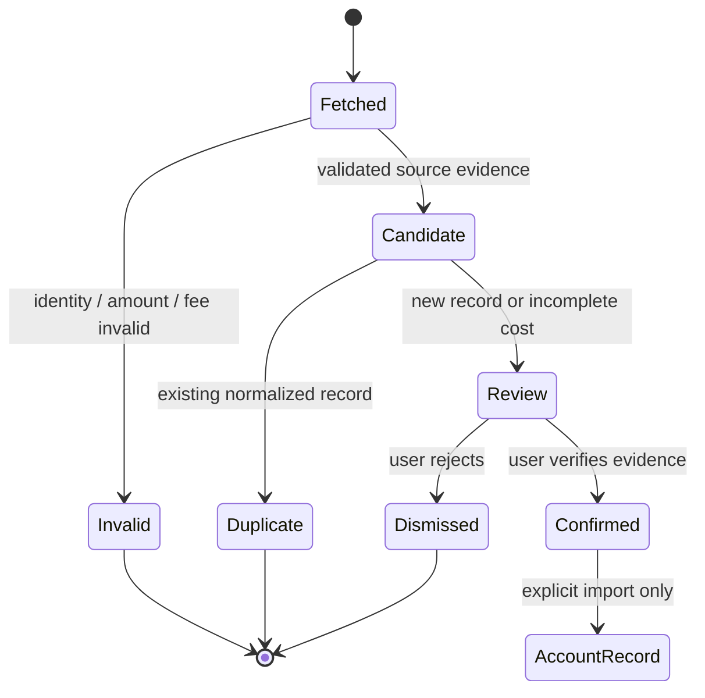
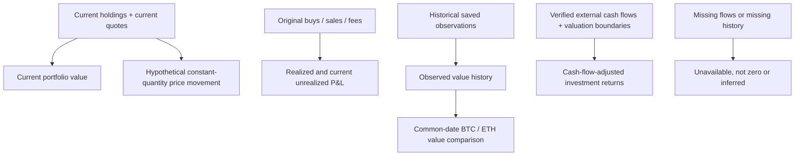

# Orbit analytics implementation

The attached 25-feature roadmap is implemented as independently reviewed modules behind **Analytics**. Each module has a dedicated agent task. Only the selected tool loads its script and data; all private data uses the current authenticated account.

## Architecture

## Record review

Transfer review decisions annotate evidence and do not create purchases or alter accounting. Quantity alignment does not verify purchase cost.

## Analytics boundaries

A public provider page is not an API license. No paid subscription is assumed. Exchange coverage, observed sample windows, collection gaps, and modeled scenarios must remain visible in each tool. Read-only observations never become execution guarantees.

## Research basis

- [CoinStats portfolio analytics](https://help.coinstats.app/en/articles/3621267-portfolio-analytics): allocation, portfolio history, fees and performance tools.
- [CoinMarketCap feature overview](https://coinmarketcap.com/academy/article/coinmarketcap-features-track-research-and-build-with-crypto-data): asset research, watchlists and indicators.
- [CoinGlass API overview](https://docs.coinglass.com/reference/getting-started-with-your-api): derivative, liquidation and order-flow data families.
- [CoinGlass footprint](https://www.coinglass.com/footprint?symbol=SOL): execution-level views and explicit exchange coverage.

## Feature inventory and verification

The final inventory below is completed after integration testing. Individual `feature_*.md` documents contain module-specific formulas, constraints and tests.

| # | Analytics tool | Implemented capability and boundary |
|---|---|---|
| 1 | Exchange history | Reviewed historical fill pages plus read-only deposits, withdrawals and actual Earn reward timelines; explicit bounded windows, no guessed USD fees. |
| 2 | Transfer review | Two-sided owned-wallet direct-transfer evidence, exact chain/hash/event/amount; decisions never invent purchases. |
| 3 | Missing-cost review | Missing/zero distinction and statement-backed corrections to original purchases with stale-record checks. |
| 4 | Historical portfolio | Actual saved observations, source separation, gaps, partial and freshness labels. |
| 5 | Period P&L | UTC daily/month/year/custom realized sales P&L; historical unrealized stays unavailable without cost-matched valuations. |
| 6 | Asset performance | Exact position details, current costs/returns, fees and ledger transaction timeline. |
| 7 | BTC/ETH comparison | Common-date indices and optional declared-flow Modified Dietz estimate; no inferred external flows. |
| 8 | Fees/income | Recorded trade costs, payer-owned native gas and explicitly manual reward/payment evidence; unknown historical USD stays unknown. |
| 9 | Multiple portfolios | Private named membership views and per-source deduplicated Combined totals. |
| 10 | Time machine | On/before UTC-date browsing and explicit detailed wallet snapshot capture; no backcasting. |
| 11 | Portfolio heatmap | Exact proportional SVG allocation, source/return controls and full accessible position table. |
| 12 | Target allocation | Account-saved exact-position targets, draft preview/export and source-separated drift. |
| 13 | Concentration | Transparent grouping and HHI; classifications only from verified taxonomy membership, never tickers. |
| 14 | Named watchlists | Private lists, exact catalog IDs, notes and selectable columns. |
| 15 | Coin comparison | Two to four coins, common-date normalized histories and valuation/supply metrics. |
| 16 | Portfolio alerts | Saved ledger value/allocation/return rules, explicit fresh-quote checks and bounded in-app event history. |
| 17 | Relevant news | Existing cached headlines prioritized by known holdings/watchlist, conservative matching and deduplication. |
| 18 | Unlock calendar | Source-linked manual events and supplied/as-of supply percentages; no supply-derived schedules or assumed paid feed. |
| 19 | Funding history | Binance/Bybit public settlements, true timestamps, partial failures and hypothetical notional costs. |
| 20 | Price + OI | Same-instrument Binance history with exact timestamp joins, units, volume and funding observations. |
| 21 | Order-book heatmap | Explicit server-verified captured quotes, bounded retention and visible collection gaps; not liquidation data. |
| 22 | CVD | Bounded normalized taker-print delta with resets, gaps and distinct USD/USDT units. |
| 23 | Multi-exchange footprint | Separate Binance Spot/Coinbase Spot execution cells; no false cross-currency aggregation or historical archive. |
| 24 | Liquidations | Explicit eight-second public OKX observation, 100-record cap, contract units and unknown USD notionals. |
| 25 | Liquidation scenario | User-entered isolated-margin model, not observed positions or a licensed CoinGlass heatmap. |

## Integration and verification

- All 25 modules use the explicit asset allowlist and authenticated feature dispatcher.
- The authenticated app allows only the specific public OKX WebSocket in addition to same-origin connections; no account data is transmitted in that subscription.
- Initial combined Python regression: **550 tests passed, 21 optional tests skipped**. All frontend `.test.cjs` suites passed. Post-review changes have additional targeted regressions.
- Live public funding smoke check: 90 Binance and 90 Bybit settlement observations returned. Live price/OI smoke check: 288 price rows, 288 OI observations and 36 funding observations returned.
- Browser automation timed out. Browser visual/phone verification is not claimed; component, chart geometry, HTTP and static-build checks are recorded separately.
- Private real-exchange credentials were not exercised by test requests. Exchange endpoint tests use fixtures; users still review actual imports before confirmation.

Review fixes: stale Analytics state refresh, partial-history preservation, future freshness provenance, fail-closed adjusted-return boundaries, and explicit Solana/Sui gas-payer attribution.

Final regression: all 53 frontend test suites plus the exchange activity UI test passed; 63 feature backend tests and 56 affected integration tests passed after review. Static build and whitespace checks passed.
